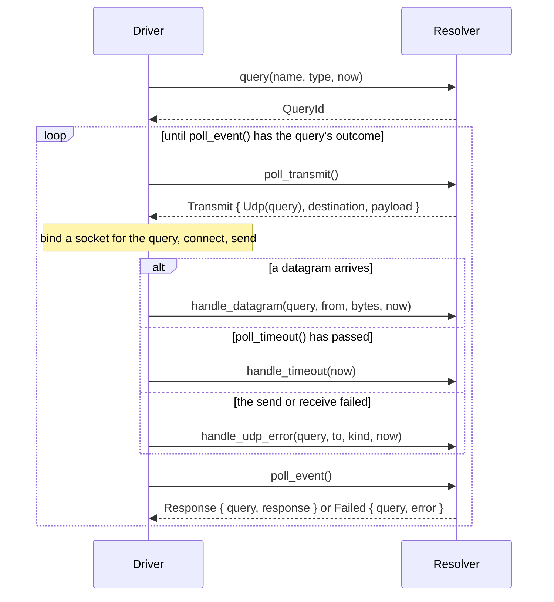
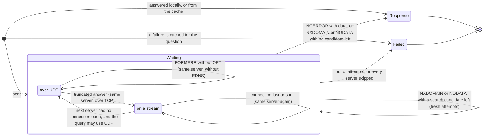

# sansio-dns

[](https://crates.io/crates/sansio-dns)
[](https://docs.rs/sansio-dns)

> [!WARNING]
> This is an experiment: me trying out sans-IO and the DNS RFCs. It is incomplete and
> probably incorrect in places, so don't rely on it for anything that matters.

A DNS stub resolver for Rust, in two crates:

- [`sansio-dns-tokio`](https://crates.io/crates/sansio-dns-tokio)
  ([docs](https://docs.rs/sansio-dns-tokio)) looks up host names on Tokio and plugs into
  reqwest. Start here if you want addresses.
- [`sansio-dns`](https://crates.io/crates/sansio-dns) ([docs](https://docs.rs/sansio-dns))
  is the core: a state machine over UDP, TCP and DNS over TLS that owns no sockets, timers
  or tasks. You feed it bytes and the time, and it tells you what to send. Use it to run
  the same resolver on blocking std, compio, an embedded event loop, or in tests without a
  network.

Where DNS behaviour is a matter of convention, such as `resolv.conf`, search domains and
the hosts file, both follow glibc; where an RFC specifies it, they follow the RFC, and
[docs/spec-coverage.md](docs/spec-coverage.md) lists what the tests pin.

## Looking up host names with Tokio

```toml
[dependencies]
sansio-dns-tokio = "0.1"
```

```rust,ignore
let resolver = sansio_dns_tokio::Resolver::from_system_conf()?;
let addresses = resolver.lookup_ip("example.com").await?;
```

`from_system_conf` reads `/etc/resolv.conf`, `/etc/hosts`, `LOCALDOMAIN` and `RES_OPTIONS`
the way glibc does. `Resolver::new(config)` takes a [`Config`](#configuration) you build
yourself; on Windows, where there is no `resolv.conf`, that is the way to go. `lookup_ip`
takes a host name (non-ASCII ones are converted as browsers convert them) or an IP address,
and returns the addresses IPv6 first by default; see [address families](#address-families).

The resolver is cheap to clone. Its clones share one background task, spawned on the
runtime of the first lookup, and the task's TCP and TLS connections, which stay open
between lookups until they go idle. Keep a resolver within one runtime. Dropping a lookup's
future cancels its queries. Call `flush_cache()` when the host's network changes, since
cached failures from the old network shouldn't hold on the new one.

With its `reqwest` feature, the resolver plugs into reqwest:

```rust,ignore
let client = reqwest::Client::builder()
    .dns_resolver(sansio_dns_tokio::Resolver::from_system_conf()?)
    .build()?;
```

A small HTTP client built this way:

```sh
cargo run -p sansio-dns-tokio --features reqwest --example get -- https://example.com
```

## What it does

- **Transports.** UDP first, with EDNS at 1232 bytes. A truncated answer switches the query
  to TCP. One TCP connection per server, kept open for 10 s after the last query, shared and
  pipelined by all queries to that server (RFC 7766). DNS over TLS with the `tls` feature.
- **Retries.** Each query gets two attempts per server, rotating through the servers,
  waiting 5 s on the first round and 10 s on the second. A server that doesn't answer goes
  to the back of the line for a minute. See [how a query moves on](#how-a-query-moves-on).
- **Names.** Search domains with `ndots`, a hosts file, and local answers for `localhost`,
  `invalid.`, `onion.` and multicast DNS names.
- **Coalescing.** A query for a name and type already in flight joins it instead of being
  sent, so parallel lookups of one host share their queries.
- **Caching.** Failures (1 s, backing off to 30 s) and negative answers (up to an hour),
  per question. Answers with data are not cached.

Cargo features, all off by default:

| Crate | Feature | Adds |
|---|---|---|
| `sansio-dns` | `tls` | DNS over TLS through rustls: `Config::with_tls` |
| `sansio-dns-tokio` | `tls` | The same, for the driver |
| `sansio-dns-tokio` | `reqwest` | `reqwest::dns::Resolve` for `Resolver` |

The minimum supported Rust version is 1.88. The core depends only on
[`hickory-proto`](https://crates.io/crates/hickory-proto), which it re-exports as
`sansio_dns::hickory_proto`, and on rustls with `tls`.

## Driving the resolver yourself

The core's `Resolver` is a state machine. Every call takes `now: Instant`, and it never
blocks or waits: the driver does the I/O it asks for and feeds back what happens. One
query over UDP, with a retry, looks like this; a stream goes the same way through
`TcpConnect`, `TcpWrite` and `TcpClose` transmits and `handle_stream_data`,
`handle_stream_closed` and `handle_stream_error`.



`lookup_ip` runs the A and AAAA queries the same way and merges their addresses into
`poll_lookup`. Before stopping, call `shutdown` and carry out its transmits, which close
the open connections.

A blocking driver for one query over UDP, in full:

```rust,no_run
use std::io::ErrorKind;
use std::net::UdpSocket;
use std::time::{Duration, Instant};

use sansio_dns::hickory_proto::rr::{Name, RecordType};
use sansio_dns::{Config, Event, Resolver, Transport};

fn main() -> Result<(), Box<dyn std::error::Error>> {
    let server = "1.1.1.1:53".parse()?;
    let mut resolver = Resolver::new(Config::new(server, []));
    let name = Name::from_ascii("example.com")?;
    let query = resolver.query(name, RecordType::A, Instant::now())?;

    // A fresh socket per query, connected to its server (RFC 5452 §9), and a
    // buffer that holds any datagram: a server may send more than the 1232
    // bytes the query asks for.
    let socket = UdpSocket::bind("0.0.0.0:0")?;
    socket.connect(server)?;
    let mut buf = vec![0; 65535];

    loop {
        while let Some(t) = resolver.poll_transmit() {
            match t.transport {
                Transport::Udp(_) => {
                    if let Err(e) = socket.send(&t.payload) {
                        resolver.handle_udp_error(query, server, e.kind(), Instant::now());
                    }
                }
                // A truncated answer switches the query to TCP. examples/std.rs
                // handles TcpConnect, TcpWrite and TcpClose.
                _ => return Err("TCP needed".into()),
            }
        }
        match resolver.poll_event() {
            Some(Event::Response { response, .. }) => {
                println!("{:?}", sansio_dns::addresses(&response)?);
                return Ok(());
            }
            Some(Event::Failed { error, .. }) => return Err(error.into()),
            None => {}
        }
        let deadline = resolver.poll_timeout().ok_or("nothing pending")?;
        let wait = deadline.saturating_duration_since(Instant::now());
        socket.set_read_timeout(Some(wait.max(Duration::from_millis(1))))?;
        match socket.recv(&mut buf) {
            Ok(n) => resolver.handle_datagram(query, server, &buf[..n], Instant::now()),
            Err(e) if matches!(e.kind(), ErrorKind::WouldBlock | ErrorKind::TimedOut) => {
                resolver.handle_timeout(Instant::now());
            }
            Err(e) => resolver.handle_udp_error(query, server, e.kind(), Instant::now()),
        }
    }
}
```

Complete drivers with TCP are in [`examples/`](examples): `std` (blocking), `tokio`,
`compio` and `dot` (DNS over TLS), about 150 lines each.

```sh
cargo run --example std -- example.com 1.1.1.1:53
```

What a driver must do, so that the resolver's checks hold (the crate docs' [driver
obligations](https://docs.rs/sansio-dns/latest/sansio_dns/#driver-obligations) have the
reasons and the details):

- **UDP.** Bind a fresh socket per query (`Transport::Udp` names it) in the server's address
  family, connect it to the server, and bind a new one when the query moves to another
  server. Pass the query and the source address as received with each datagram to
  `handle_datagram`, read into a 65535-byte buffer, and report a failed bind, connect, send
  or receive with `handle_udp_error`.
- **Streams.** `TcpConnect(id)` opens a connection and writes the payload, `TcpWrite(id)`
  writes to it, and `TcpClose(id)` closes it once the writes before it are done; a
  `TcpWrite` can arrive before the connection is up, so queue it. Write each payload in
  one call, with `TCP_NODELAY` set. Pass everything read to `handle_stream_data`, and
  report a close with `handle_stream_closed` and an I/O error with `handle_stream_error`.
  After reporting one, still write what was queued for the connection before the report.
- **Over TLS**, the resolver drives the session in memory and the driver only moves bytes.
  The last write before a `TcpClose` carries the close_notify alert, so it must go out.
- **Stopping.** Call `shutdown` and carry out its transmits first. Call `flush_cache` when
  the host's network changes.

The `Response` event holds the server's answer as a hickory `Message`; `addresses(&message)`
takes the addresses out of it, following the CNAME chain. Empty answers (NXDOMAIN, NODATA)
arrive there too, with their response code in `response.metadata.response_code`.

## Configuration

`Config::new(first, more)` takes the servers in the order they are asked. The defaults:

| Field | Default | Meaning |
|---|---|---|
| `timeout` | 5 s | Wait for an answer on the first round; doubled on each round through the servers. A `Timeout`, kept between 1 s and 300 s |
| `attempts` | 2 per server | Attempts per query, across all servers |
| `search` | none | Search domains, tried in order |
| `ndots` | 1 | A name with at least this many dots is tried as given before the search domains |
| `tld_query` | true | Also try a single-label name as given when there are search domains |
| `unicast_local_zones` | none | Zones under `local.` that the name servers serve |
| `hosts` | none | Static entries, from `Hosts::parse` |
| `ip_strategy` | `Ipv6First` | Which families `lookup_ip` asks for, and which come first |
| `idle_timeout` | 10 s | Close a stream connection after this long without a query |
| `failure_memory` | 60 s | A server that didn't answer goes after the others for this long. A `FailureMemory`, at most 5 min |
| `failure_cache` | 1 s, 30 s | A failed question isn't sent again for the shortest time, doubling up to the longest on repeated failures. A `FailureCache`, both between 1 s and 5 min |
| `max_negative_ttl` | 1 h | Cap on how long NXDOMAIN and NODATA are cached |
| `cache_entries` | 1024 | Failures and negative answers held; the oldest are dropped first |

`Config::from_resolv_conf(&bytes)` reads a `resolv.conf` as glibc does: up to three
`nameserver`s, `search` or `domain`, and the options `ndots`, `timeout`, `attempts`,
`no-aaaa` and `no-tld-query`. `Config::from_resolv_conf_with_env` also applies
`LOCALDOMAIN`, `RES_OPTIONS` and the host name's domain. `Config::hosts = Hosts::parse(&bytes)`
adds a hosts file. You read the files; the core opens none.

Names under `localhost.`, `invalid.` and `onion.`, hosts file entries, and multicast DNS
names (`local.` and the link-local reverse zones) are answered without a query, unless a
search domain such as Kubernetes' `cluster.local` or `Config::unicast_local_zones` says the
name servers serve them.

### Address families

`Config::ip_strategy` picks which families `lookup_ip` asks for and which come first:
`Ipv6First` (the default), `Ipv4First`, `Ipv4Only` or `Ipv6Only`. IPv6 comes first even on
a host without a global IPv6 address, such as a container with only a ULA, where
`getaddrinfo` puts IPv4 first. There, race the connections (Happy Eyeballs, RFC 8305), as
hyper does, or use `IpStrategy::Ipv4First`.

[docs/configuration.md](docs/configuration.md) has the details: what exactly is read from
`resolv.conf` and how that differs from glibc, how a search proceeds after NXDOMAIN, NODATA
and failures (and where glibc and musl differ), the locally answered names, and the host
name rules of the Tokio driver's `lookup_ip`.

## How a query moves on

A query's first attempt goes to the first server that hasn't failed to answer recently,
and each next attempt to the next server, wrapping around. With `Config::new`'s defaults
and two servers, the four attempts wait 5, 5, 10 and 10 seconds, so a query that nobody
answers fails after 30 seconds; with one server, after 15.



A "next server" move uses up one of the query's attempts and, after no answer, puts the
server behind the others for a minute; a "same server" move is free, once. A failure is
cached for the question, 1 s at first and twice as long on each failure soon after, up to
30 s, and queries for it fail at once meanwhile. A search candidate is sent at most three
times to each server over each transport (RFC 9520 §3.1), and every wait is between 1 s
and 300 s, so every query ends in bounded time. The crate docs' [How a query moves
on](https://docs.rs/sansio-dns/latest/sansio_dns/#how-a-query-moves-on) has the full table,
with the attempt and deadline each move takes, and its
[Cache](https://docs.rs/sansio-dns/latest/sansio_dns/#cache) section what is cached for how
long.

## DNS over TLS

With the `tls` feature, `Config::with_tls(client, server_name)` sends every query over TLS
(RFC 7858) and authenticates the servers as `server_name` (RFC 8310 strict profile).
`Config::with_tls_names(client, names)` gives each server its own name, so servers of
different operators can be mixed. Servers on port 53 are refused: DNS over TLS uses port
853 or another agreed port, never 53. Queries are padded to a multiple of 128 octets (RFC
8467) and carry an EDNS Client Subnet option with source prefix length 0, which asks the
server not to pass the client's address on (RFC 8310 §11.1).

The crate brings rustls without a crypto provider or root store: build the `ClientConfig`
with the ones you want. For the strict profile, keep rustls' default WebPKI verifier (a
custom verifier that accepts more gives the profile up), TLS 1.3, session resumption and
SNI, and set `alpn_protocols` to `[b"dot"]`, the ALPN identifier IANA registered for DNS
over TLS. A `ServerName::IpAddress` is matched against the certificate's IP addresses,
which is not one of RFC 8310's authentication mechanisms. `examples/dot.rs` uses ring and
the webpki roots:

```sh
cargo run --example dot --features tls -- example.com 1.1.1.1:853 cloudflare-dns.com
```

## Compared with hickory-resolver

[hickory-resolver](https://crates.io/crates/hickory-resolver) is the established async
resolver for Rust, and the one behind reqwest's `hickory-dns` feature. The `compare/` crate
measures both on the job a reqwest client gives them, against a name server on localhost.
On an M3 Pro, with hickory-resolver 0.26.3 and its cache off:

| | sansio-dns-tokio | hickory-resolver |
|---|---|---|
| `lookup_ip` over UDP | 226 µs | 311 µs |
| `lookup_ip` after a truncated answer, over TCP | 305 µs | 396 µs |
| reqwest GET on a new connection | 396 µs | 425 µs |
| Heap allocations per UDP lookup, incl. 18 by the test server | 67 | 145 |
| Stripped binary size over reqwest's default resolver | +0.58 MB | +1.44 MB |

On localhost the times are mostly task wakeups; on a real network the round trip to the
server dominates. With its cache on, hickory answers a repeated lookup in about 1 µs, and
sansio-dns caches no answers with data yet.

Where the two behave differently:

| | sansio-dns | hickory-resolver |
|---|---|---|
| Runtime | Sans-IO core for any runtime, plus a Tokio driver | Tokio; its `RuntimeProvider` needs `Send + Sync` |
| EDNS | Always on at 1232 bytes, dropped once on `FORMERR` | From the system config only with `options edns0` |
| Truncated answer over TCP | Used as it is | The lookup fails |
| Hosts entry with only an IPv4 address | Empty AAAA answer, as glibc does | AAAA asked from DNS |
| Address families | Both, IPv6 first, by default; or IPv4 first, or one family | The same, plus asking for the second family only when the first has no address |
| Names with `_` | Resolved | Rejected |
| Non-ASCII names | UTS 46 over the whole name, as browsers do: `bücher。example` asks for `xn--bcher-kva.example` | Converted label by label, so `。` ends up inside a label |
| `local.` names | NXDOMAIN without a query, unless under a search domain such as `cluster.local` or a configured zone | Sent to the name servers |
| Cache | Failures (1 s, backing off to 30 s) and negative answers, 1024 entries | Positive and negative, 8192 entries |
| Server order | As configured; one that failed to answer goes after the others for a minute | By measured latency, two servers raced |
| Transports | UDP, TCP, DoT | Also DoH, DoH3, DoQ and DNSSEC validation |
| System configuration | `resolv.conf` as glibc reads it, `LOCALDOMAIN`, `RES_OPTIONS`, the host name's domain, and hosts | Also Windows, and macOS through SystemConfiguration; no `LOCALDOMAIN` or `RES_OPTIONS` |
| Tokio lookups | `lookup_ip` | Any record type, reverse lookups, typed helpers |

## Not implemented

- Opportunistic (unauthenticated) TLS.
- SPKI pin sets (RFC 7858 §4.2) and raw public keys (RFC 8310 §9), and DANE authentication
  (RFC 8310 §8.2), which needs DNSSEC validation.
- EDNS TCP keepalive (RFC 7828) to negotiate the idle timeout with the server.
- DoH/DoQ.
- A cache of answers with data: only failures and negative answers are cached.
- DNS cookies (RFC 7873): queries carry no COOKIE option.
- `resolv.conf` options other than the ones above (`rotate`, `use-vc`, `sortlist`, …).
- Sorting addresses by the host's own ones (RFC 6724 §6); `lookup_ip` lists them by family,
  in the server's order within each.
- Once EDNS is dropped for a query, it stays off for that query's remaining attempts,
  including other servers, until the search moves to the next candidate.
- Multicast DNS (RFC 6762) for `local.` names.
- Rejecting the code points that IDNA2008 marks DISALLOWED (RFC 5891 §5.4, RFC 5892): the
  Tokio driver's `lookup_ip` follows UTS 46, as browsers do, and accepts some of them, such
  as `☃`.
- IPv6 addresses with a zone (`fe80::1%eth0`, RFC 4007 §11) in the Tokio driver's
  `lookup_ip`.
- Reading the system configuration on Windows or through macOS' SystemConfiguration.

## More

- The [crate docs](https://docs.rs/sansio-dns) have the full lifecycle table, the cache
  rules and the driver obligations; the [Tokio driver's](https://docs.rs/sansio-dns-tokio)
  describe its background task and runtime behaviour.
- [docs/configuration.md](docs/configuration.md): `resolv.conf`, search domains, hosts
  file, locally answered names, host name rules.
- [docs/spec-coverage.md](docs/spec-coverage.md): the RFC sections followed, and what each
  pins.
- [docs/testing.md](docs/testing.md): running the tests, where they live, fuzzing and
  benchmarks.
- [AGENTS.md](AGENTS.md): the architecture, for working on the code.

## License

Licensed under either of [Apache License, Version 2.0](LICENSE-APACHE) or
[MIT license](LICENSE-MIT) at your option. Unless you explicitly state otherwise, any
contribution you submit for inclusion in this crate, as defined in the Apache-2.0 license,
is dual licensed as above, without any additional terms or conditions.
